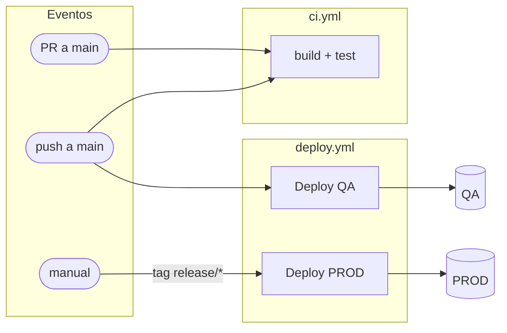

# Diagramas Mermaid para GitHub Actions

## Diagrama general (`flowchart LR`)

Cuatro columnas, de izquierda a derecha: **eventos → workflows → jobs → destinos**.

## Convenciones

| Elemento | Forma | Ejemplo |
|---|---|---|
| Evento | Estadio `([...])` | `E1(["push a main"])` |
| Workflow | `subgraph` con el nombre del archivo | `subgraph ci["ci.yml"]` |
| Job | Rectángulo `[...]` | `J1["build + test"]` |
| Ambiente o destino | Cilindro `[(...)]` | `QA[("QA")]` |
| Servicio externo | Hexágono `{{...}}` | `S3{{"S3"}}` |
| Aprobación manual | Rombo `{...}` | `A{"aprobación"}` |

- **Condición en una flecha:** `-- "texto" -->` (por ejemplo, `-- "si paths src/**" -->`).
- **Flecha punteada** `-.->` para relaciones indirectas: notificaciones, o un workflow que escucha a otro (`workflow_run`, artefacto, release).
- **`needs`:** flecha entre jobs dentro del mismo subgraph.

## Reglas para que no falle

- Ids simples: letras, números y `_`. Sin espacios, puntos ni guiones.
- Todo texto con espacios, `/`, `*`, `:`, `(`, `)`, `.` o acentos, entre comillas dobles.
- No usar `end` como id (es palabra reservada).
- Un diagrama de más de ~25 nodos se vuelve ilegible: dividirlo (general + uno por workflow).
- Para un workflow con varios jobs y `needs`, usar `flowchart TD` (de arriba hacia abajo).
